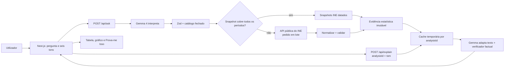
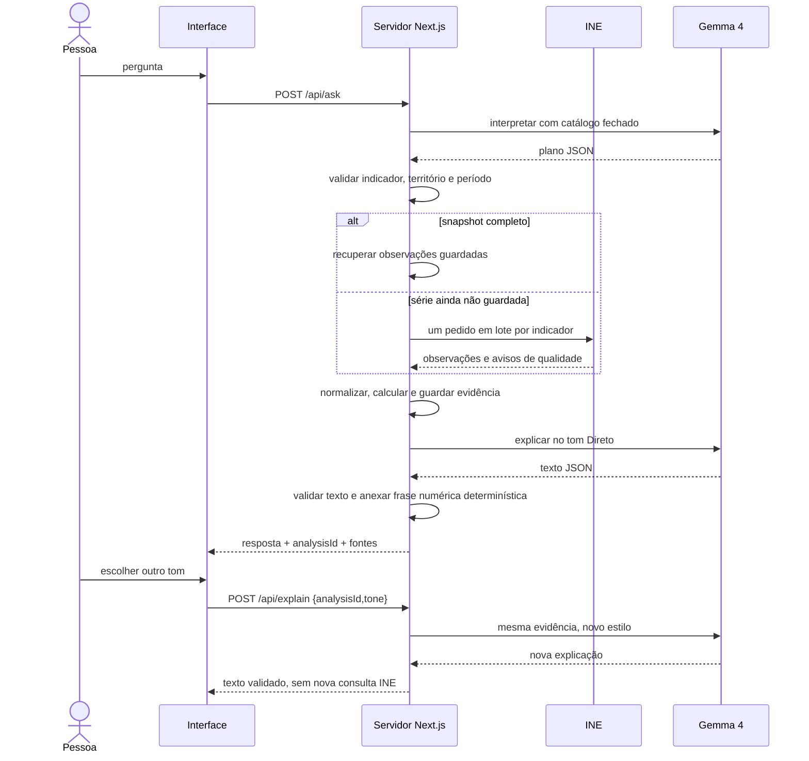

# Pergunta ao INE — plano de produto e lançamento

**Autoria:** [FullGrip.ai](https://fullgrip.ai/) · **Código:** MIT · **Idioma:** português de Portugal · **Execução atual:** aplicação web Next.js, sem câmara nem hardware adicional.

## 1. Promessa do produto

Uma pessoa pergunta por um município ou indicador e recebe uma resposta que consegue verificar: valor, período, unidade, definição, cálculo, aviso de qualidade e ligação ao INE. O Gemma 4 interpreta a pergunta e adapta a explicação a públicos diferentes. O modelo não fornece números para a base de dados nem decide sozinho que duas séries são comparáveis.

Perguntas subjetivas como “qual a melhor cidade para viver?” abrem uma escolha de critérios e acesso à comparação disponível; não produzem uma recomendação geral com base apenas nas rendas. A assinatura FullGrip.ai fica no rodapé da interface.

## 2. Arquitetura

**Provider:** Ollama local por omissão. `PROVIDER=gemini` usa Gemma 4 `gemma-4-26b-a4b-it` pela Gemini API quando há chave; em falha recorre ao Ollama. A interface identifica o fornecedor efetivo ou o template factual quando o modelo falha. A [documentação da Google](https://ai.google.dev/gemma/docs/core/gemma_on_gemini_api) confirma o modelo na API. O [desafio da MLH “Best Use of Gemma 4”](https://www.mlh.com/events/hacktoberfest-hack-day-chennai-x-android-club-vitc/challenges/01a03b87-be22-9180-5e2d-b3beeb66666d) apresenta a Gemini API como via do desafio. **A via Gemini está implementada, mas não foi testada com chave real nesta sessão.**

## 3. Catálogo e evidências verificadas

| Vista | Indicador INE | Período e território guardados | Unidade / ressalva |
| --- | --- | --- | --- |
| Perguntas, Batalha, Raio-X | `0014711` renda mediana de novos contratos | 2021–2025, Portimão, Faro, Lagos, Albufeira; 20 células num pedido | €/m²; novos contratos, quartil 2 |
| Perguntas, Raio-X | `0012918` população residente | Portimão, 2025 | pessoas; sexo HM e idade total |
| Perguntas | `0012136` taxa de desemprego | Algarve, 2024T3–2026T2; oito trimestres num pedido | %; comparar trimestre homólogo e preservar § |
| Raio-X | `0012653` ganho médio mensal | Portimão, 2021 e 2024 | €; trabalhadores por conta de outrem a tempo completo com remuneração completa |
| Raio-X | `0013312` hóspedes por habitante | Portimão, 2022–2025 | número por habitante; alojamento turístico |
| Raio-X | `0012765` resíduos urbanos recolhidos por habitante | Portimão, 2021–2024 | kg/habitante |

As respostas literais, metadados, URLs e datas estão em `fixtures/ine/`; os snapshots derivados estão em `data/snapshots/`. O parser de perguntas livres mantém **três indicadores** (rendas, população e desemprego). Os outros três estão no Raio-X até existir um mapeamento de linguagem natural e dimensões validado para cada pergunta.

### Orçamento de pedidos ao INE

| Ação | Pedidos ao INE com os snapshots incluídos |
| --- | ---: |
| Abrir Início, Raio-X, história ou Batalha de rendas | 0 |
| Perguntar por rendas de até duas das quatro cidades em 2021–2025, população de Portimão em 2025 ou desemprego geral do Algarve | 0 |
| Mudar tom, comparar estilos, mostrar prova | 0 |
| Pergunta fora da cobertura guardada mas dentro do catálogo | 1 por indicador, com períodos e territórios em lote |
| Atualizar as cinco séries do Raio-X em direto | Até 5, um lote por indicador |

Há fila, cache de uma hora, timeout e pausa quando a API indica limite de taxa. Valores em falta não são inventados nem convertidos em zero. Um snapshot só substitui uma consulta se cobrir **todos** os períodos pedidos com valores numéricos.

## 4. Ordem de produção e estado

| Fase | Resultado | Estado |
| --- | --- | --- |
| P0 · verdade dos dados | 20 rendas, oito trimestres, comparação homóloga, provenance e snapshots | Concluído localmente |
| P1 · Gemma com rigor | seis tons, evidência imutável, `POST /api/explain`, validação numérica, fallback factual | Concluído localmente |
| P2 · experiência | Batalha com ranking inicial, Raio-X com cinco temas, descoberta com scroll/prova, estados de espera, UI móvel, exportação de texto e preferência de tom na sessão | Concluído localmente |
| P3 · lançamento público | alojamento, cache partilhada, volume persistente, chave Gemini para demonstração do prémio, repositório público e revisão da atribuição de dados | Por preparar |

### Guião de demonstração

1. Perguntar “Como evoluíram as rendas em Portimão?” e mostrar cinco anos, frase com 7,09 → 11,36 €/m² e fonte.
2. Trocar entre Direto, Professor e Sarcástico; abrir “Comparar estilos” e mostrar que tabela, gráfico e cálculos não mudam.
3. Abrir a Batalha e mostrar o ranking das quatro cidades em 2025: Lagos 12,34; Albufeira 11,44; Portimão 11,36; Faro 9,67 €/m².
4. Abrir o Raio-X, ver cinco indicadores, a história renda/ganho e a descoberta de Lagos, com “Prova-me Isso”.
5. Perguntar pelo desemprego do Algarve e mostrar oito trimestres e a comparação homóloga 2025T2 4,5% → 2026T2 4,2% (−0,3 p.p.), incluindo o sinal de qualidade §.

## 5. Critérios antes de publicar

- `npm run lint`, `npm test` e `npm run build` sem erros; revisão visual em desktop e telemóvel.
- Teste real da via Gemini com chave do projeto e selo `Gemma 4 · Gemini API` antes de afirmar elegibilidade ao prémio.
- Persistir evidências por `analysisId` numa cache partilhada em deploy com várias instâncias; a implementação atual usa memória de um processo durante 30 minutos.
- Configurar `INE_SNAPSHOT_DIR` num volume persistente para pedidos feitos após o deploy.
- Publicar código MIT com assinatura FullGrip.ai e atribuir os dados ao INE, mantendo separados os termos dos dados e do modelo.

O [mapa de perguntas](./QUESTION_MAP.md) define os limites da primeira versão e os pedidos esperados.
